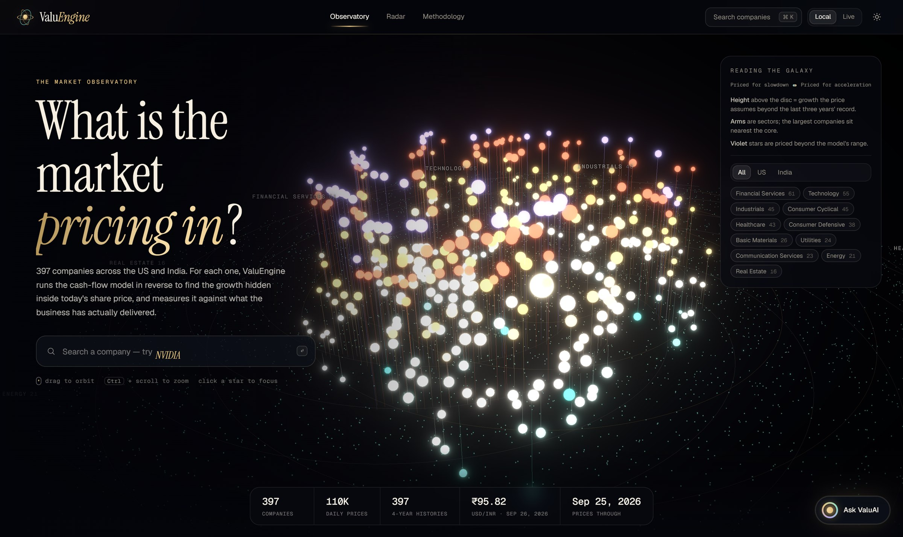
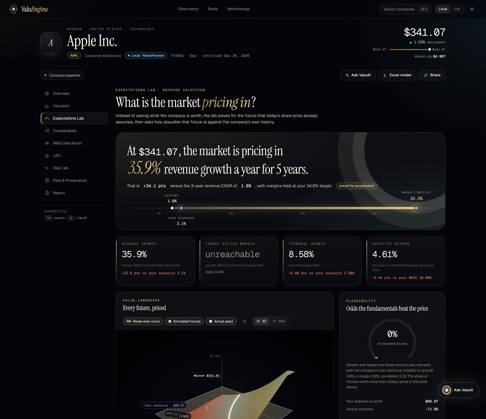
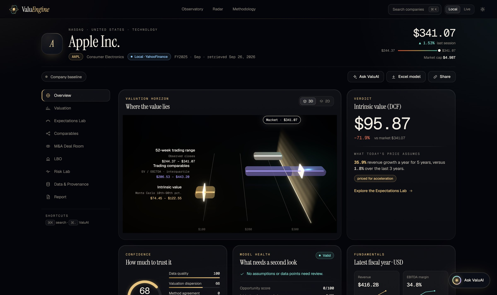
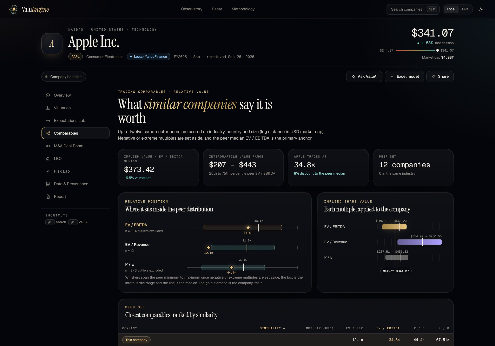
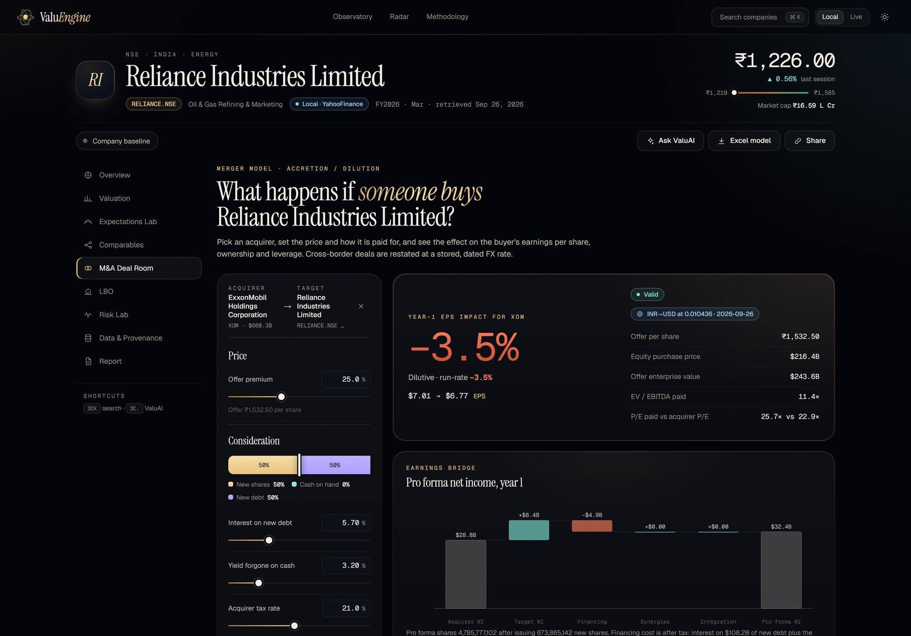
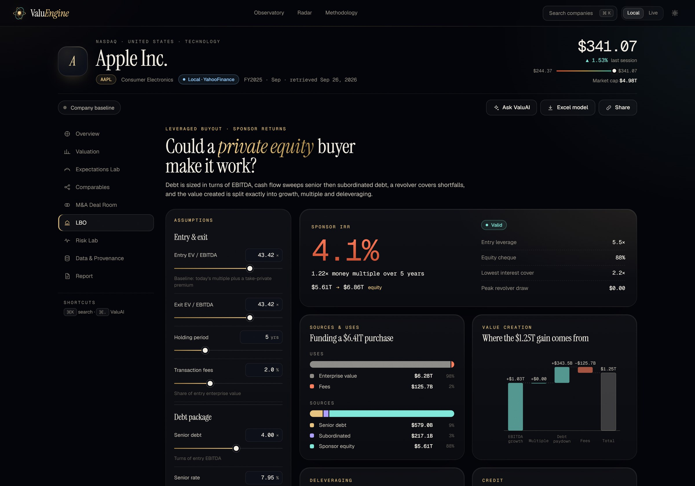
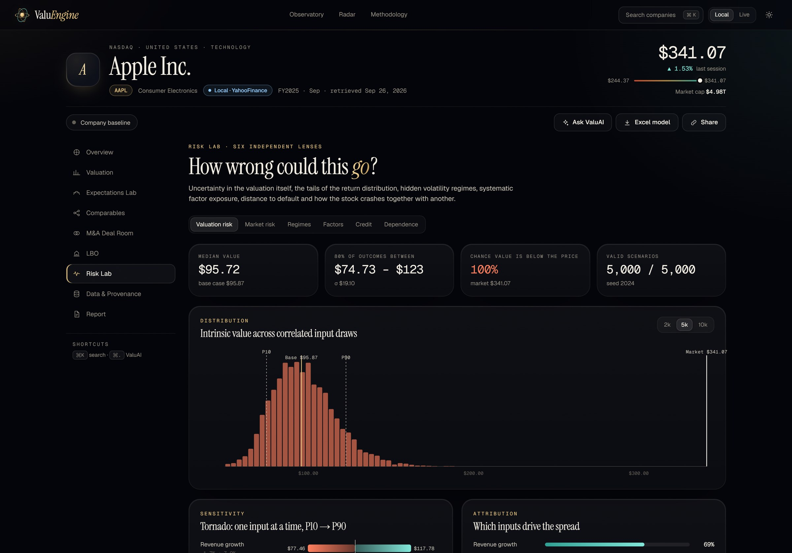
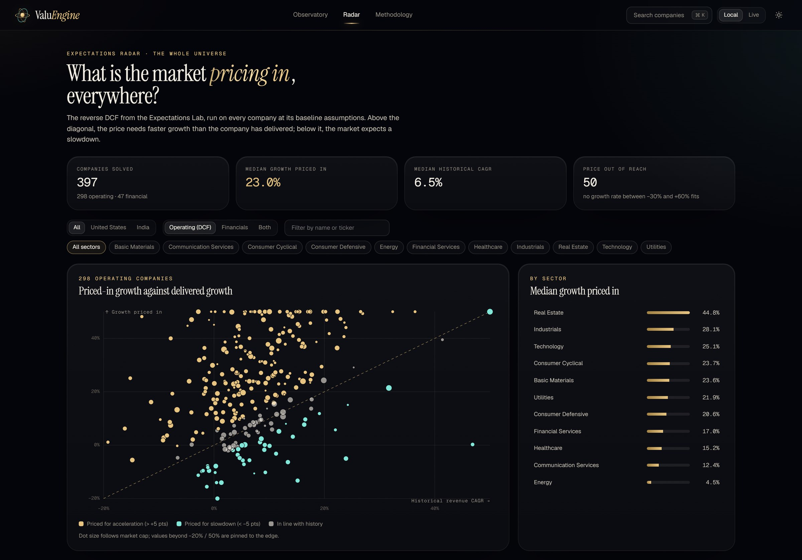
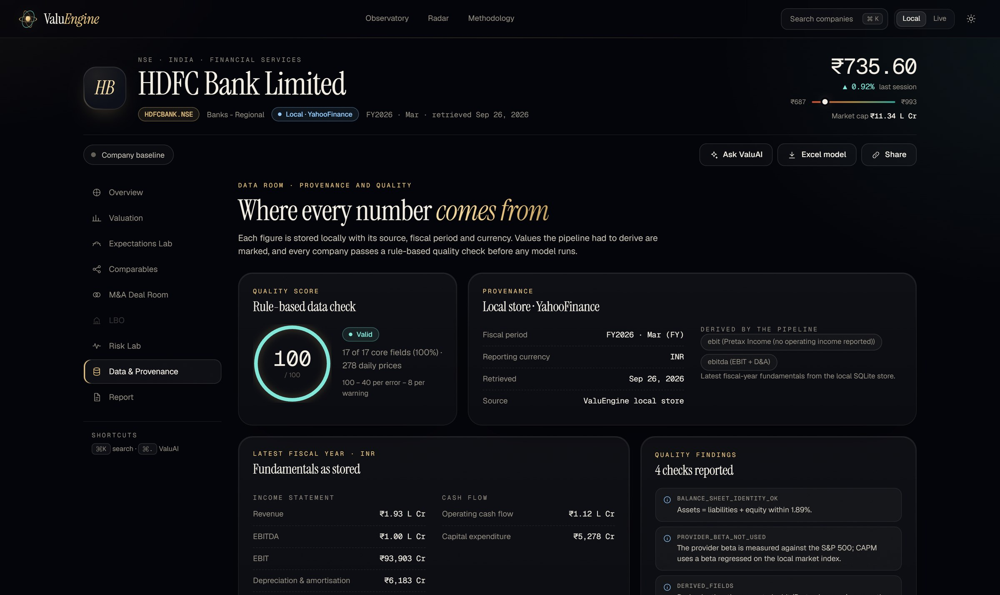
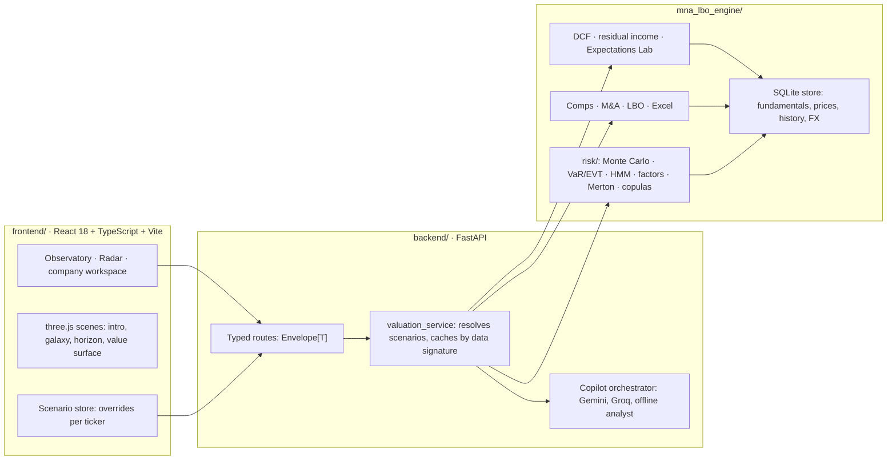

<div align="center">



<br/>

# ValuEngine

**An equity valuation workstation for 397 US and Indian companies.**

Prices a company with a DCF or excess-return model, then answers the question most models skip:
***what future is today's share price already assuming?***

[](#quick-start)
[](#api)
[](#quick-start)
[](#the-rest-of-the-workstation)
[](frontend/vite.config.ts)
[](#tests)
[](LICENSE)

397 companies · 110K+ daily prices · US + India · offline-first · not investment advice

</div>

---

It also includes:

- comparables, a merger model and an LBO
- a six-lens quantitative risk lab
- an Excel export built from live formulas
- a streaming AI copilot, all driven by one shared scenario

Everything runs **offline** from a local database. API keys only unlock live data and LLM answers — there is nothing to configure to get the full experience on day one.

---

## Highlights

### The Expectations Lab

A reverse DCF. Holding every other assumption at your scenario, the engine solves (grid scan + Brent's method) for the single value of each driver that makes intrinsic value equal the market price:

- **Implied revenue growth, EBITDA margin, terminal growth and expected return:** each is compared with your scenario and with the company's own history.
- **Value landscape (3D):** a 33 × 33 surface of value per share over growth and margin, cut by a glass plane at the market price. The glowing curve where they meet is every future that justifies today's price exactly. The company's actual fiscal years are plotted on it.
- **Plausibility odds:** thousands of (growth, margin) futures are drawn with the company's own historical volatility, and the share that is worth more than the price is reported.
- **Banks and insurers:** the equivalent question is answered through price-to-book, giving the ROE the market is pricing in.
- **Expectations Radar:** the same reverse DCF runs across the whole universe, showing the widest gaps between price and history, sector medians, and a sortable ranking.

<div align="center">

</div>

### The rest of the workstation

| Area | What it does |
|---|---|
| **Observatory** | A 3D galaxy of every company. Arms are sectors, and height is the gap between the growth priced in and the growth delivered. Hover, focus or double-click to open. |
| **Overview** | A 3D "valuation horizon": the 52-week range, comparables range and Monte Carlo intrinsic range as glass bars under a light curtain at the market price. It also shows a verdict, a computed confidence score, model-health flags, fundamentals, and prices with a volatility-regime strip. |
| **Valuation** | A DCF console with drag-to-scrub inputs, each with a baseline tick. It uses a value-driver terminal value (`NOPAT × (1 − g/RONIC) / (WACC − g)`), an exit-multiple option, the mid-year convention and a margin ramp. It also shows the EV bridge, the projection table and two sensitivity grids. Banks use a residual-income model instead. |
| **Comparables** | Up to 12 peers scored on industry, country and log-size distance. Each multiple is shown as a box strip with the company placed within it, and implied values as a football field. |
| **M&A deal room** | Pick any acquirer, including a cross-border one restated at a dated FX rate. Set the premium and the stock / cash / new-debt mix (a draggable bar), plus synergies. You get year-1 and run-rate accretion, an earnings bridge, break-even synergies, ownership and leverage. |
| **LBO** | Debt sized in turns of EBITDA, a revolver and a cash sweep. Shows IRR and MOIC, an exact value-creation attribution (EBITDA growth + multiple + debt paydown − fees), the debt schedule and a five-scenario stress test. |
| **Risk lab** | Six lenses:<br>• correlated Monte Carlo with a tornado chart and variance attribution<br>• VaR / ES (historical, normal and Cornish-Fisher)<br>• EVT (a POT/GPD fit)<br>• 2-state HMM volatility regimes<br>• Fama-French-style factors built from the universe, with Newey-West errors<br>• Merton distance to default, and copula tail dependence (Gaussian, Student t, Clayton and Gumbel, selected by AIC) |
| **Data room** | Provenance for every field, derived-field flags, a rule-based quality score, and four years of statements. |
| **IC memo** | A committee memo written from the live model outputs, drafted by the LLM when a key is set and by a deterministic analyst template otherwise. It can be printed or exported. |
| **Excel** | A workbook of live formulas (assumptions, DCF or residual income, sensitivities, accretion, LBO, comps and checks). The tests recalculate it and reconcile it against the Python engines. |
| **ValuAI** | A streaming copilot (SSE) grounded in the same numbers and your scenario. It uses Gemini, then Groq, then a rule-based offline analyst, so it never goes silent. |

**Design:**

- The **Observatory** (dark) and **Paper** (light editorial) themes, switched with a view-transition "eclipse".
- A particle-armillary 3D intro.
- Instrument Serif, Geist and Geist Mono typography.
- A ⌘K command palette.
- Reduced-motion and no-WebGL fallbacks: every 3D view has a 2D equivalent.

---

## Visual tour

<table>
<tr>
<td width="50%">

<p align="center"><b>Overview</b> — 52-week range, comps range and Monte Carlo range as a 3D valuation horizon</p>
</td>
<td width="50%">

<p align="center"><b>Comparables</b> — peer scoring, box strips and an implied-value football field</p>
</td>
</tr>
<tr>
<td width="50%">

<p align="center"><b>M&A deal room</b> — cross-border accretion / dilution with a live earnings bridge</p>
</td>
<td width="50%">

<p align="center"><b>LBO</b> — sources & uses, an exact value-creation waterfall and a stress test</p>
</td>
</tr>
<tr>
<td width="50%">

<p align="center"><b>Risk lab</b> — correlated Monte Carlo, a tornado chart and variance attribution</p>
</td>
<td width="50%">

<p align="center"><b>Expectations Radar</b> — the reverse DCF run across all 397 companies</p>
</td>
</tr>
</table>

<div align="center">

<p><b>Data room</b> — provenance for every field, and a rule-based data-quality score</p>
</div>

---

## Quick start

**Requirements:** Python 3.11+ and Node 18+.

### 1. API

```bash
python -m venv .venv
.venv\Scripts\activate          # Windows  (macOS/Linux: source .venv/bin/activate)
pip install -r requirements.txt
uvicorn backend.main:app --reload --port 8000
```

On first start with no database, the API builds `data/financial_data.db` from the committed snapshot in `data/snapshot/`. This takes a few seconds and needs no network. You can also run it explicitly with `python scripts/bootstrap_data.py`.

### 2. UI

```bash
cd frontend
npm install
npm run dev                      # http://localhost:5173 — proxies /api to 127.0.0.1:8000
```

Point the dev proxy elsewhere with `VALUENGINE_API_URL=http://host:port npm run dev`.

### 3. Optional configuration

Copy `.env.example` to `.env`. Every setting is optional:

| Variable | Effect |
|---|---|
| `GEMINI_API_KEY`, `GROQ_API_KEY` | LLM answers and memos (tried in order; any failure falls through to the offline analyst) |
| `ALPHA_VANTAGE_API_KEY` | "Live" data mode; without it live mode serves the local store, labelled `LOCAL_FALLBACK` |
| `VALUENGINE_API_TOKEN` / `VITE_API_TOKEN` | Bearer-token auth for every `/api` route except `/api/health` |
| `VALUENGINE_CORS_ORIGINS` | Allowed browser origins |
| `VALUENGINE_WARMUP` | Build the factor model and universe radar in the background at start-up (`1`, the default) |

---

## Refreshing the data

The committed snapshot covers 397 companies (US and NSE-listed India):

- fiscal-year fundamentals
- four years of statement history
- daily prices from August 2025
- dated USD/INR rates

| Task | Command |
|---|---|
| Re-ingest fundamentals and prices | `python scripts/ingest_company_universe.py [--tickers AAPL,RELIANCE.NSE] [--overwrite]` |
| Fetch statement history | `python scripts/ingest_history.py [--tickers …] [--overwrite]` |
| Update FX rates | `python scripts/update_fx.py [--currencies INR] [--period 2y]` |
| Preview or apply idempotent repairs | `python scripts/repair_local_store.py [--dry-run]` |
| Write the snapshot back to `data/snapshot/` | `python scripts/export_snapshot.py` |
| Check the universe definition | `python scripts/validate_universe.py` |

Ingestion never fabricates values:

- Statements reported in another currency are restated.
- EBITDA below EBIT is rebuilt as EBIT + D&A.
- Missing capex is estimated from the company's own history and flagged as derived.
- Records that fail the quality engine are rejected.

---

## Tests

```bash
pip install -r requirements-dev.txt
pytest                           # engines, data layer, API contract, copilot, Excel reconciliation
cd frontend
npm test                         # formatters, SSE parser, scenario logic
npm run build                    # strict TypeScript + production bundle
```

The frontend's API types are generated from the Pydantic response models (`python scripts/generate_ts_types.py`). A test fails if they drift.

Continuous integration runs the same two suites on every push — see [`.github/workflows/ci.yml`](.github/workflows/ci.yml).

---

## API

All responses share one envelope: `{ status, data, warnings, errors, provenance }`.

- `status` is one of `VALID`, `REVIEW_REQUIRED`, `INVALID`, `UNAVAILABLE`, `LOCAL`, `LIVE`, `LOCAL_FALLBACK`, `RATE_LIMITED` or `ERROR`.
- Scenario endpoints take `{ ticker, mode, dcf?, excess_return?, lbo?, mna? }`, where each section holds only the overrides; anything omitted uses the company baseline.
- Interactive OpenAPI docs are served at `/docs`.

| Method | Route | Purpose |
|---|---|---|
| GET | `/api/health`, `/api/meta` | Liveness; dataset coverage, FX, providers |
| GET | `/api/companies/search?q=` | Search by name or ticker |
| GET | `/api/company/{t}` · `/baseline` · `/history` | Company record; baseline assumptions with notes; statement history |
| GET | `/api/data-quality/{t}` | Quality findings and score |
| POST | `/api/valuation/intrinsic` · `/api/valuation/sensitivity` | DCF or residual income; sensitivity grids |
| POST | `/api/expectations` | Expectations Lab (reverse DCF, frontier, surface, odds) |
| GET | `/api/expectations/universe` | Expectations Radar across the universe |
| GET | `/api/comps/{t}` · `/transactions` | Trading comparables; precedent transactions (`UNAVAILABLE`) |
| POST | `/api/mna/run` · `/api/lbo/run` · `/api/lbo/stress` | Merger model; LBO; LBO stress test |
| POST | `/api/model-health` · `/api/risk/confidence` | Diagnostics and opportunity score; valuation confidence |
| POST | `/api/risk/monte-carlo` | Monte Carlo, tornado and attribution |
| GET | `/api/risk/{var,evt,regime,factors,merton}/{t}` · `/api/risk/copula/{a}/{b}` | Risk-lab models |
| POST | `/api/reports/excel` | Live-formula workbook |
| POST | `/api/ai/copilot` · `/api/ai/copilot/stream` · `/api/ai/memo` | Copilot (JSON or SSE) and IC memo |

---

## Architecture



```
backend/            FastAPI app, typed response schemas, services (valuation, copilot, offline analyst), security
mna_lbo_engine/     config (market parameters), modules/ (engines, data layer, providers), modules/risk/
frontend/src/       lib/ (API client, generated types, queries, scenario, formatting), components/, pages/, three/, styles/
scripts/            data ingestion, snapshot export/bootstrap, FX, repairs, TypeScript type generation
data/               universe definition, committed snapshot (the SQLite database itself is generated)
docs/               METHODOLOGY.md (every formula, default and limitation) and screenshots/
tests/              pytest suite
```

---

## Methodology and limitations

[`docs/METHODOLOGY.md`](docs/METHODOLOGY.md) documents every formula, default and threshold. In summary:

- Baselines come from each company's own statements and history, and its own country's market parameters.
- Indian companies use a local-market regression beta.
- Models return `INVALID` / `UNAVAILABLE` with a reason instead of an unreliable number.

**Limitations:**

- Data is annual only, with about a year of daily prices.
- Yahoo Finance data can contain errors.
- Share counts are basic rather than fully diluted.
- There is no precedent-transaction database.
- Rates are static per currency.

ValuEngine is an analytical tool, **not investment advice**.

---

<div align="center">

## License

MIT — see [LICENSE](LICENSE).

</div>
